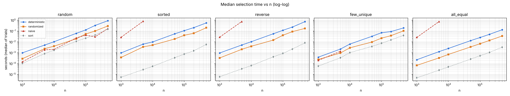
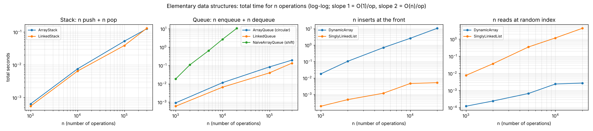

# Assignment 6: Medians and Order Statistics & Elementary Data Structures

Pure-Python implementations of linear-time selection algorithms (Part 1) and
elementary data structures built from scratch (Part 2), with tests, benchmarks
and a full written analysis.


## Repository layout

```
selection/                    Part 1
  deterministic_select.py     Median of Medians: worst-case O(n)
  randomized_select.py        Randomized Quickselect: expected O(n) (+ naive baseline)
  _common.py                  validation, insertion sort, three-way partition
data_structures/              Part 2
  array.py                    DynamicArray (manual doubling/halving)
  matrix.py                   Matrix (row-major; row/col insert & delete, transpose, @)
  stack.py                    ArrayStack, LinkedStack
  queue.py                    ArrayQueue (circular buffer), LinkedQueue, NaiveArrayQueue
  linked_list.py              SinglyLinkedList (head + tail)
  rooted_tree.py              RootedTree, left-child/right-sibling (optional part)
benchmarks/
  benchmark_selection.py      Part 1 empirical analysis
  benchmark_data_structures.py  Part 2 empirical comparison
tests/                        39 unit tests (unittest, no extra dependencies)
results/                      CSV data, plots and logs produced by the benchmarks
demo.py                       Short tour of every structure and algorithm
```

## Requirements

* Python 3.8+ (developed and measured on 3.13)
* `matplotlib`, only for generating plots (`pip install -r requirements.txt`).
  Everything else uses the standard library.

## How to run

All commands are run from the repository root.

```bash
# quick tour
python demo.py

# run all tests
python -m unittest discover -s tests -t . -v

# Part 1 benchmark (~45 s; --quick for a smaller run)
python -m benchmarks.benchmark_selection

# Part 2 benchmark (~1 min)
python -m benchmarks.benchmark_data_structures
```

Using the code:

```python
from selection import deterministic_select, randomized_select, deterministic_median

deterministic_select([7, 2, 9, 4, 4, 1], 3)   # -> 4   (k is 1-based)
randomized_select([7, 2, 9, 4, 4, 1], 3)      # -> 4
deterministic_median([9, 1, 8, 2, 7, 3])      # -> 3   (lower median)

from data_structures import ArrayQueue, SinglyLinkedList
q = ArrayQueue(); q.enqueue(1); q.enqueue(2); q.dequeue()   # -> 1
ll = SinglyLinkedList([1, 2, 3]); ll.reverse(); ll.to_list()  # -> [3, 2, 1]
```

## Summary of findings

**Part 1: selection**

| | Deterministic (Median of Medians) | Randomized Quickselect |
|---|---|---|
| Time | O(n) worst case | O(n) expected, O(n²) worst (probability ≈ 2⁻ⁿ) |
| Extra space | O(log n) stack (+ O(n) input copy) | O(1) (+ O(n) input copy) |
| Measured work (elements scanned / n) | ≈ 3.0–3.4, flat from n = 10k to 500k | ≈ 3.0–3.9 (theory: 3.39 for the median) |
| Measured speed | 2–4× slower | fastest |

* Both algorithms are linear on random, sorted, reverse-sorted, few-unique and
  all-equal inputs. Time per element stays flat as n grows 500×.
* Three-way partitioning handles duplicates: an all-equal array finishes in one pass.
* A naive last-element-pivot quickselect is Θ(n²) on sorted input:
  230–2,200× slower than randomized select at n = 5,000.
* Python's built-in C `sorted()` is still faster than pure-Python linear selection,
  because interpreter constants (≈ 50–100×) outweigh the log n factor.



**Part 2: data structures**

* Array-based and linked stacks/queues are all O(1) per operation and measured
  linear. In CPython they perform about the same, but linked nodes use 4–6× more
  memory (48 vs 8–13 bytes per item).
* The large differences come from operation patterns that don't fit the structure:
  front insertion into an array and a shifting (non-circular) array queue are Θ(n²)
  overall (≈ 2,000× slower at n = 20k), while random indexing into a linked list is
  Θ(n²) overall (≈ 1,600× slower).
* The circular buffer is what makes an array queue O(1).



